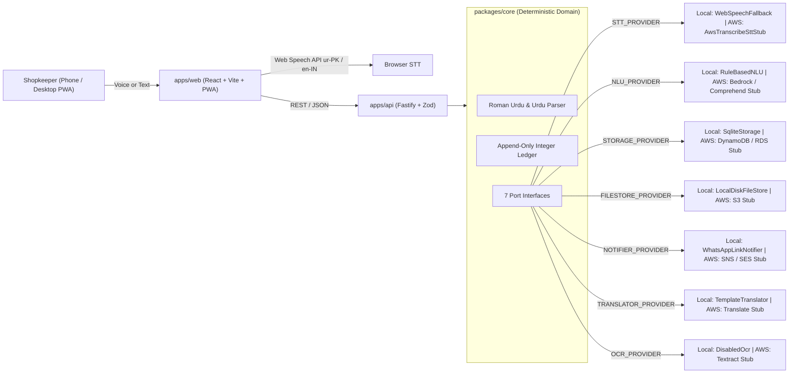

# Khata Saathi Architecture

Khata Saathi is built with a **Ports and Adapters (Hexagonal)** architecture so that all business rules (deterministic Roman Urdu/Urdu parsing, integer-only rupee maths, append-only ledger events, payment-pattern calculation) live in `packages/core` with zero cloud dependencies, while external capabilities sit behind typed interfaces.

## System Diagram

## Key Invariants

1. **Integer-only money**: Every amount is validated as a positive integer (`Number.isInteger(amount) && amount > 0`). No floating-point arithmetic is ever used.
2. **Append-only ledger**: The `transactions` table only accepts inserts. Undoing an entry appends a reversing `adjustment` event referencing `reversedTxId` so audit history is never lost.
3. **Human-in-the-loop Confirm**: The parser (and any future LLM adapter) only *proposes* a `ParsedEntry`. Nothing is persisted until the shopkeeper taps **Confirm**.
4. **Draft-only reminders**: Reminders are generated as `wa.me` links and copyable text. Nothing is ever auto-sent.
